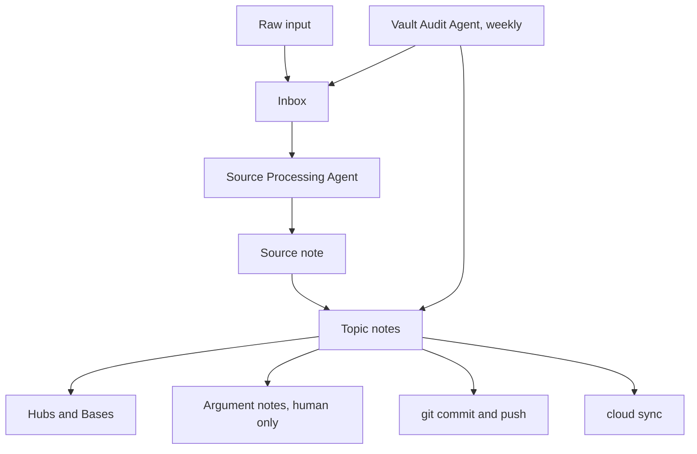

[ai-life-vault-architecture-docs-architecture-md.md](https://github.com/user-attachments/files/34613843/ai-life-vault-architecture-docs-architecture-md.md)
# Architecture

## The stack

| Layer | Tool | Role |
|---|---|---|
| Editor | Obsidian | Editing, wikilinks, graph view, plugin host |
| Data | Plain Markdown files | The vault itself, one file per note |
| Sync and off-site copy | Cloud drive mirroring the folder | Local editing with continuous sync |
| Version history | git + a private GitHub remote | Byte-level source of truth, pushed automatically |
| Agent runtime | A free CLI coding agent (Gemini CLI-class) | Runs the two agents locally, reads a conventions file (`AGENTS.md`) |
| Drafting | An in-chat AI with a cloud-drive connector | Drafts new files remotely into a staging area |

Nothing in the stack is paid: the editor's personal tier, the private repo, the sync, and the agent runtime are all free.

## The data flow

Raw input becomes linked knowledge through one pipeline:

In words: material lands in the Inbox. The Source Processing Agent converts it into a lean source note (a thesis plus a handful of verbatim receipts, each with a block ID) and into atomic topic notes where every claim cites `[[Source_Note#^block-id]]`. Hubs and Bases dashboards assemble themselves from note metadata. The human writes argument notes, which synthesize topics into positions and are off-limits to agents. The Vault Audit Agent runs weekly and checks structure, never content.

## Two layers of truth

* **The audit log is the narrative layer.** It is append-only: a run heading, one line per change (action, path, reason), and a summary per run. Even no-change runs are logged. It answers "what was done and why".
* **git is the proof layer.** A free plugin auto-commits and pushes roughly every ten minutes. It answers "exactly which bytes changed, and can we roll back". Editor state files (`workspace.json` and similar) are gitignored, so commits track content, not editor chrome.

On any disagreement between the two, git wins. This split mirrors how a ticketing system relates to configuration backup: the ticket explains intent, the backup proves state.

## Remote changes: the two-phase bridge

The in-chat AI can create and read files in the vault's cloud folder, but never update or delete them. That constraint became a feature: every remote change follows a two-phase protocol.

1. **Draft.** The in-chat AI, acting under the source-processing conventions, writes new files into a staging folder (`Inbox/Agent_Staging/RUN-<date>-<NN>/`) together with a run manifest: final paths, exact edits, the audit log section to append, and a compliance checklist.
2. **Grant or deny.** The human reviews the staged files and deletes anything rejected. Deletion is the only veto needed.
3. **Apply.** A standing command in the local agent runtime moves the surviving files to their final paths, applies manifest edits verbatim, appends the audit log section, and clears the staging folder.

Integrity rules: staged notes are verified before applying (link count, footer, front matter, citations). On any conflict the agent stops and reports instead of improvising. A staging folder older than seven days is treated as structural drift by the audit agent, the same way an overdue change ticket would be. That is change management applied to a folder of notes: draft, approval, deployment window, audit trail.
